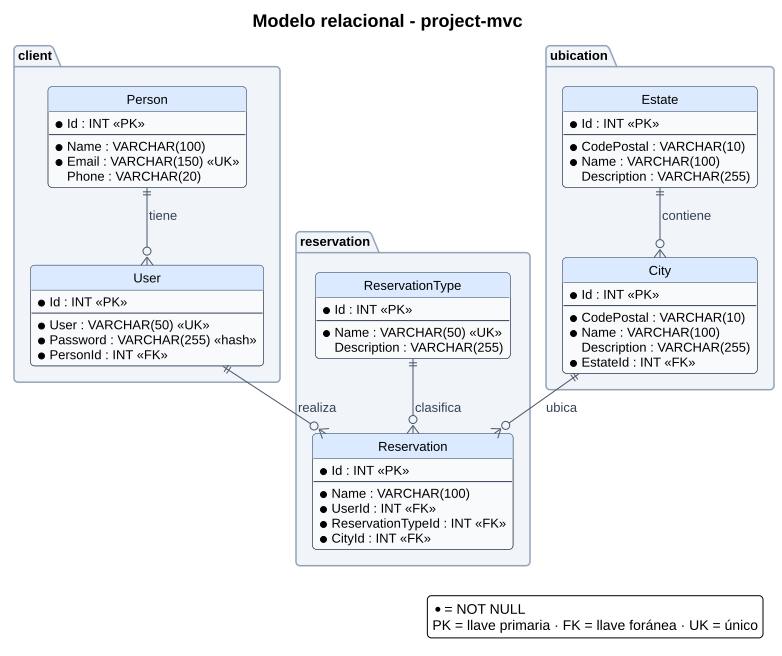

# Modelo relacional (MR)

## Diagrama

## Tablas

### Módulo client

| Tabla | Columna | Tipo | Restricción |
|---|---|---|---|
| Person | Id | INT | PK, autoincremental |
| Person | Name | VARCHAR(100) | NOT NULL |
| Person | Email | VARCHAR(150) | NOT NULL, UNIQUE |
| Person | Phone | VARCHAR(20) | |
| User | Id | INT | PK, autoincremental |
| User | User | VARCHAR(50) | NOT NULL, UNIQUE |
| User | Password | VARCHAR(255) | NOT NULL (se guarda el hash) |
| User | PersonId | INT | NOT NULL, FK → Person.Id |

### Módulo reservation

| Tabla | Columna | Tipo | Restricción |
|---|---|---|---|
| ReservationType | Id | INT | PK, autoincremental |
| ReservationType | Name | VARCHAR(50) | NOT NULL, UNIQUE |
| ReservationType | Description | VARCHAR(255) | |
| Reservation | Id | INT | PK, autoincremental |
| Reservation | Name | VARCHAR(100) | NOT NULL |
| Reservation | UserId | INT | NOT NULL, FK → User.Id |
| Reservation | ReservationTypeId | INT | NOT NULL, FK → ReservationType.Id |
| Reservation | CityId | INT | NOT NULL, FK → City.Id |

### Módulo ubication

| Tabla | Columna | Tipo | Restricción |
|---|---|---|---|
| Estate | Id | INT | PK, autoincremental |
| Estate | CodePostal | VARCHAR(10) | NOT NULL |
| Estate | Name | VARCHAR(100) | NOT NULL |
| Estate | Description | VARCHAR(255) | |
| City | Id | INT | PK, autoincremental |
| City | CodePostal | VARCHAR(10) | NOT NULL |
| City | Name | VARCHAR(100) | NOT NULL |
| City | Description | VARCHAR(255) | |
| City | EstateId | INT | NOT NULL, FK → Estate.Id |

## Relaciones

| Relación | Cardinalidad | Regla al borrar |
|---|---|---|
| Person → User | 1 : N | No se borra una Person que tenga User |
| User → Reservation | 1 : N | No se borra un User que tenga Reservation |
| ReservationType → Reservation | 1 : N | No se borra un tipo en uso |
| Estate → City | 1 : N | No se borra un Estate que tenga City |
| City → Reservation | 1 : N | No se borra una City que tenga Reservation |

## Observaciones

- **Person → User es 1 : N.** Si cada persona solo puede tener un usuario, basta con poner `UNIQUE` en `User.PersonId`.
- **Reservation.CityId conecta el módulo reservation con ubication:** cada reserva se hace en una ciudad.
- **Motor: MySQL 8.4.** Las tablas usan InnoDB y utf8mb4 para que las llaves foráneas funcionen y se acepten tildes y ñ.
