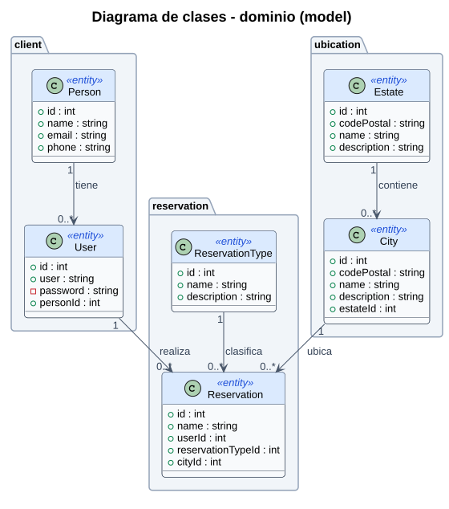
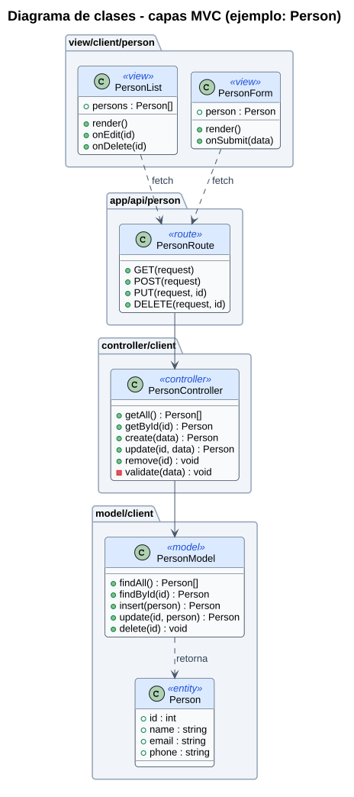
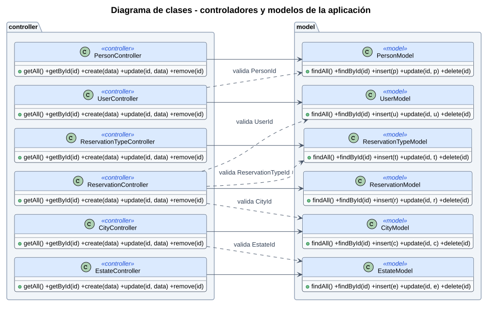

# Diagrama de clases

## 1. Clases del dominio (model)

`password` es privado: el modelo nunca lo devuelve en una consulta.

## 2. Capas MVC por entidad

Todas las entidades siguen el mismo patrón. Ejemplo con **Person**:

## 3. Controladores y modelos de la aplicación

## Archivos que corresponden a cada clase

| Clase | Archivo |
|---|---|
| PersonList, PersonForm | `src/view/client/person/` |
| UserList, UserForm | `src/view/client/user/` |
| ReservationTypeList, ReservationTypeForm | `src/view/reservation/reservation-type/` |
| ReservationList, ReservationForm | `src/view/reservation/reservation/` |
| EstateList, EstateForm | `src/view/ubication/estate/` |
| CityList, CityForm | `src/view/ubication/city/` |
| PersonController, UserController | `src/controller/client/` |
| ReservationTypeController, ReservationController | `src/controller/reservation/` |
| EstateController, CityController | `src/controller/ubication/` |
| PersonModel, UserModel | `src/model/client/` |
| ReservationTypeModel, ReservationModel | `src/model/reservation/` |
| EstateModel, CityModel | `src/model/ubication/` |
